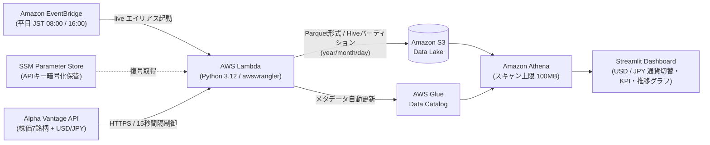
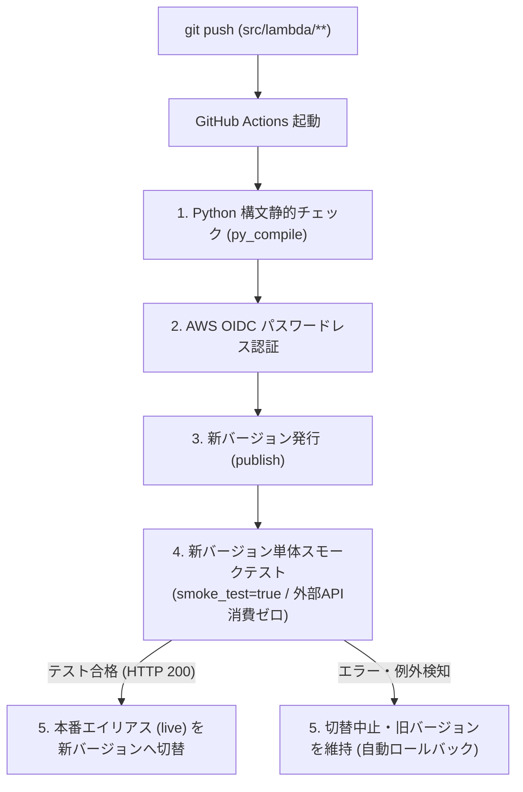

# aws-stock-ticker-etl

日米の主要株価指数連動ETF（`EWJ`, `DIA`）・主要5社（`TM`, `SMFG`, `NVDA`, `TSLA`, `ARM`）および **ドル円為替レート（`USDJPY`）** を自動収集し、AWS 上のサーバーレスデータレイクへ蓄積・可視化する ETL ＆ 分析ダッシュボードのポートフォリオです。

インフラ構築からアプリケーション開発、**GitHub Actions × OIDC × Lambda エイリアスを用いた安全デプロイ（スモークテスト＆自動ロールバック）** までをコードベースで一貫実装しています。

---

## システムアーキテクチャ

### 1. サーバーレス ETL ＆ 可視化パイプライン



### 2. CI/CD 安全デプロイフロー（GitHub Actions）

`main` ブランチへのプッシュをトリガーに、本番環境（`live` エイリアス）へ影響を与えずに新バージョンの検証を行い、合格時のみトラフィックを切り替えます。



---

## 収集対象データ

| カテゴリ | シンボル | 名称 | 備考 |
| :--- | :--- | :--- | :--- |
| **指数ETF** | `EWJ` | iShares MSCI Japan ETF | 日経平均・日本株市場の連動指標 |
| **指数ETF** | `DIA` | SPDR Dow Jones Industrial Average ETF | ダウ平均株価の連動指標 |
| **日本株ADR** | `TM` | トヨタ自動車 | 米国市場上場ADR |
| **日本株ADR** | `SMFG` | 三井住友フィナンシャルグループ | 米国市場上場ADR |
| **米国株** | `NVDA` | NVIDIA Corporation | 半導体・AI |
| **米国株** | `TSLA` | Tesla, Inc. | EV・クリーンエネルギー |
| **米国株** | `ARM` | Arm Holdings plc | 半導体IP設計 |
| **為替レート** | `USDJPY` | 米ドル / 日本円 | `CURRENCY_EXCHANGE_RATE` API で取得し円換算に利用 |

---

## 技術スタック

* **IaC（インフラ構築）**: Terraform
* **AWS クラウドサービス**:
  * **Compute / Schedule**: AWS Lambda（Python 3.12 + AWSSDKPandas Layer）, Amazon EventBridge
  * **Storage / Catalog / Query**: Amazon S3, AWS Glue Data Catalog, Amazon Athena
  * **Security / Monitoring**: AWS IAM（OIDC 認証・最小権限ポリシー）, AWS Systems Manager Parameter Store（SecureString）, Amazon CloudWatch Logs
* **CI/CD**: GitHub Actions
* **可視化・データ処理**: Python, pandas, awswrangler, Streamlit, Plotly

---

## ディレクトリ構成

```text
aws-stock-ticker-etl/
├── .github/
│   └── workflows/
│       └── deploy-lambda.yml    # 構文チェック・スモークテスト・エイリアス切替CI/CD
├── src/
│   ├── dashboard/               # Streamlit 可視化アプリケーション（機能別モジュール分割）
│   │   ├── app.py               # メイン画面・サイドバー制御（USD/JPY通貨切替・為替表示）
│   │   ├── charts.py            # KPIカード・Plotly折れ線グラフ・データテーブル描画
│   │   ├── config.py            # AWSリソース定義・銘柄ラベル・為替フォールバック設定
│   │   ├── data_loader.py       # Athenaクエリ実行・重複排除・円換算データ整形
│   │   └── requirements.txt     # ダッシュボード依存パッケージ
│   └── lambda/
│       └── handler.py           # Alpha Vantage API収集・スモークテスト・Parquet保存処理
├── terraform/                   # AWSインフラ定義一式
│   ├── main.tf                  # プロバイダ・共通データソース定義
│   ├── variables.tf             # 環境変数・スケジュール・対象銘柄定義
│   ├── s3.tf                    # データレイク＆Athena結果バケット（暗号化・ライフサイクル）
│   ├── glue_athena.tf           # Glueデータベース＆Athenaワークグループ（スキャン上限設定）
│   ├── ssm.tf                   # Alpha Vantage APIキー保管用パラメータ定義
│   ├── iam.tf                   # Lambda実行ロール＆GitHub Actions OIDC最小権限ロール
│   ├── lambda.tf                # Lambda関数本体・CloudWatchログ保持・本番エイリアス(live)
│   ├── eventbridge.tf           # 平日2回（JST 08:00 / 16:00）定期実行ルール
│   └── outputs.tf               # 構築リソースARN・バケット名出力
└── run_dashboard.sh             # ダッシュボード起動スクリプト（仮想環境自動構築対応）
```

---

## 設計上の工夫

1. **外部API制限の遵守とスキーマ統合設計**
   * Alpha Vantage 無料枠（5リクエスト/分・25リクエスト/日）を超過しないよう、リクエスト間に15秒のインターバル制御を実装しています（1回あたり8リクエスト × 平日2回 ＝ 16リクエスト/日）。
   * ドル円レート（`USDJPY`）を株価データと同一の Glue テーブルスキーマ（`stock_quotes`）に統合することで、新規テーブル追加やETLパイプラインの複雑化を防いでいます。
2. **クエリ時の重複排除と円換算（USD / JPY）機能**
   * 1日2回のバッチ実行により同一取引日（`latest_trading_day`）のデータが複数蓄積されるため、Athena 取得後に `latest_trading_day × fetched_at_jst` で最新レコードのみを抽出する重複排除ロジックを実装しています。
   * ダッシュボードのサイドバーから **USD（米ドル）** と **JPY（日本円）** をワンクリックで切り替え可能にし、適用中の最新ドル円レートと円換算価格・前日比を即座に確認できます。
3. **安全な CI/CD デプロイ（OIDC ＋ エイリアス ＋ スモークテスト）**
   * 長期的な AWS アクセスキーを一切発行せず、GitHub Actions の OIDC 認証による一時トークン発行を採用しています。
   * Lambda に `publish = true` で不変バージョンを発行し、本番定期実行は `live` エイリアスのみを参照する構成としました。デプロイ時は `{"smoke_test": true}` ペイロードで外部API枠を消費しないヘルスチェックを行い、成功時のみ `live` エイリアスを切り替えます。
4. **コスト安全設計（FinOps）**
   * **Athena**: ワークグループ単位でクエリあたりのデータスキャン上限を **100MB** に制限し、意図しないフルスキャン課金を防止。
   * **S3**: Athena クエリ結果バケットに **7日間の自動削除ライフサイクル** を設定。
   * **CloudWatch Logs**: ロググループの保持期間を **14日間** に制限し、ストレージ肥大化を防止。

---

## セットアップ・実行方法

### 1. インフラ構築（Terraform）

```bash
cd terraform
terraform init
terraform apply
```

### 2. API キーの登録（SSM Parameter Store）

株価・為替データを取得する外部サービス（Alpha Vantage API）の認証に利用するため、ソースコードへ直書きせずに暗号化保管する目的で登録します。

```bash
aws ssm put-parameter \
  --name "/stock-ticker-etl/dev/alphavantage_api_key" \
  --type "SecureString" \
  --value "<YOUR_ALPHA_VANTAGE_API_KEY>" \
  --overwrite \
  --region ap-northeast-1
```

### 3. ダッシュボードのローカル起動・閲覧手順

1. プロジェクトルートで起動スクリプトを実行します（初回は `.venv` 作成とパッケージ導入も自動で行われます）。

```bash
sh run_dashboard.sh
```

2. コマンド実行後、自動でブラウザが開きます（開かない場合はターミナルに表示される `http://localhost:8501` へアクセスします）。
3. 画面左側の **サイドバー** から以下の操作が可能です。
   * **表示通貨の切り替え**: `USD ($)` と `JPY (¥)` を切り替えて、適用中のドル円レート（`USD/JPY`）と円換算価格を確認
   * **表示銘柄の絞り込み**: 比較したい銘柄・指数のみを選択して KPI カードと推移グラフを動的に更新
   * **最新データの再取得**: キャッシュをクリアして Athena から最新データを再読み込み
